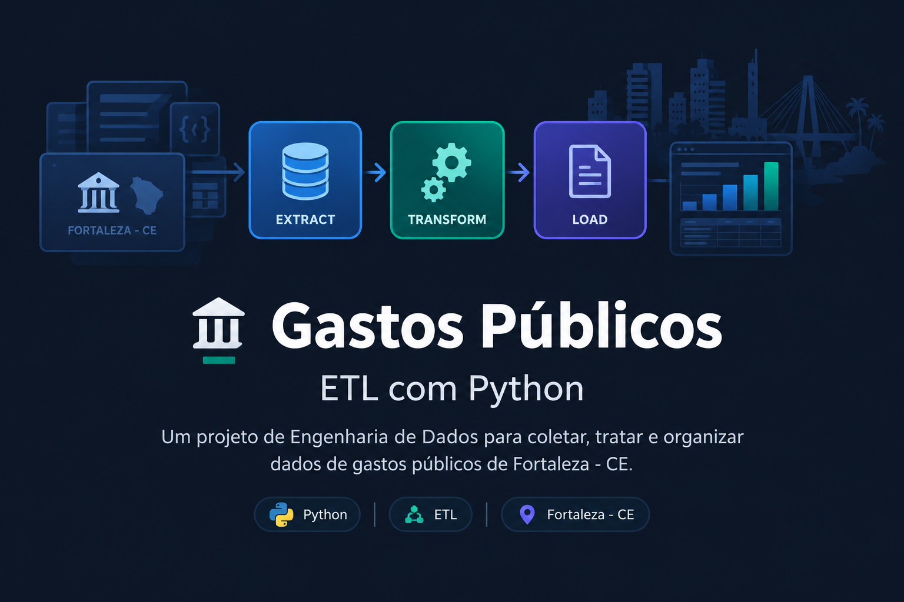

  

# Gastos Públicos — ETL com Python

## Sobre o projeto

**Gastos Públicos** é um projeto de Engenharia de Dados desenvolvido em Python com o objetivo de trabalhar com dados relacionados às despesas públicas de Fortaleza, no Ceará.

O projeto busca aplicar os conceitos fundamentais de um processo ETL (*Extract, Transform, Load*), organizando a coleta e o processamento dos dados em etapas para facilitar sua utilização em análises futuras.

Este projeto faz parte dos meus estudos práticos em Engenharia de Dados.

## Objetivos

- Praticar os fundamentos de Engenharia de Dados utilizando Python.
- Trabalhar com dados públicos e fontes de dados governamentais.
- Implementar etapas de extração, transformação e preparação dos dados.
- Organizar o código de forma modular, facilitando futuras melhorias no pipeline.

## Tecnologias utilizadas

- **Python:** desenvolvimento da lógica do pipeline e processamento dos dados.

## Como funciona o ETL

O projeto segue o conceito de ETL, dividido em três etapas principais:

### 1. Extract — Extração

Obtenção dos dados de fontes públicas, permitindo trabalhar com informações relacionadas aos gastos governamentais.

### 2. Transform — Transformação

Tratamento e organização dos dados extraídos, preparando as informações para utilização posterior.

### 3. Load — Carga

Armazenamento dos dados processados em arquivos, organizando a saída do pipeline para facilitar o acesso e a continuidade do processamento.

## Estrutura do projeto

A organização dos diretórios e arquivos acompanha a implementação atual do pipeline. O objetivo é manter as responsabilidades do processo separadas e facilitar a evolução do projeto.

## Próximos passos

Como projeto em desenvolvimento, algumas melhorias que podem ser implementadas futuramente são:

- Aprimorar o tratamento de dados inconsistentes.
- Implementar logs e mecanismos de tratamento de erros.
- Desenvolver a etapa de carga para um banco de dados SQL.
- Automatizar a execução do pipeline.
- Criar uma camada analítica para explorar os dados processados.

## Aprendizados

O desenvolvimento deste projeto contribui para minha evolução em:

- Fundamentos de ETL.
- Manipulação e organização de dados com Python.
- Integração com fontes de dados públicas.
- Organização de código e construção de pipelines.

## Autor

**Rubens Neto**

Estudante de Análise e Desenvolvimento de Sistemas, com foco em Engenharia de Dados, Python, SQL e automação de processos.

[GitHub — soueurubens](https://github.com/soueurubens)

---

*Projeto educacional desenvolvido para praticar conceitos fundamentais de Engenharia de Dados.*
